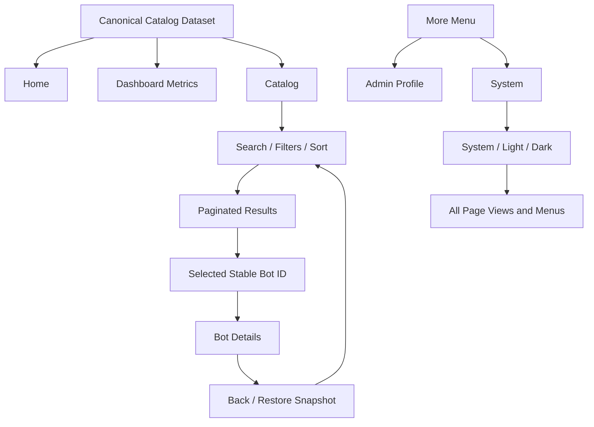

# Phase 2 — Mobile User Journey Blueprint v1.0

**Project:** Telegram Bot Master Catalog  
**Repository:** `uniquenetworkbd/Telegram-Bot-Master-Catalog`  
**Status:** Design baseline — ready for implementation planning  
**Scope:** User journeys, page responsibilities, interaction contracts, shared state, recovery, and acceptance criteria  
**Out of scope:** This document does not claim that every proposed feature is already implemented. It does not authorize a new backend, account system, catalog editor, or fabricated data.

---

## 1. Purpose and design principles

Phase 2 defines what a user can do, how each control responds, what result the user should see, and how one page hands context to another. It is the behavioral contract for the six-page catalog experience.

1. **One source of truth:** Home, Dashboard, Catalog, Details, and System must derive catalog facts from the same successfully loaded dataset.
2. **No invented facts:** Never manufacture bot descriptions, counts, popularity rankings, health states, update times, technology stacks, or owner permissions.
3. **Mobile first:** Primary actions must be reachable and usable on a narrow screen and with one hand. Important controls must not be hidden behind the keyboard or bottom navigation.
4. **Predictable Back:** Back returns to the previous meaningful context and restores the Catalog state when a user returns from Details.
5. **Progressive disclosure:** Catalog cards show concise summaries; Details shows all available fields without pretending missing fields exist.
6. **Honest feature states:** Distinguish Available, Planned, Unavailable, Loading, Error, and Unknown. Do not use a green “operational” indicator unless the state is actually checked.
7. **Shared rules across screen sizes:** Mobile and desktop use the same search, filter, sorting, and data rules.
8. **Small, maintainable scope:** This is a catalog application, not an ISP NOC, analytics service, authentication platform, or bot execution service.

## 2. Application map

### 2.1 Six page destinations

| Route key | Page | Purpose | Entry points |
|---|---|---|---|
| `home` | Home | Orientation, safe summary, quick search, primary actions | App start, brand/logo |
| `dashboard` | Dashboard | Derived catalog totals and category distribution | Bottom navigation, Home shortcut |
| `catalog` | BotCatalog | Search, filter, sort, browse and paginate records | Bottom navigation, Home, Dashboard |
| `bot` | Bot Details | Show the selected record and supported actions | Catalog card, related record, direct link |
| `profile` | Admin Profile | Public project/maintainer information | More menu |
| `system` | System | Theme, data-source facts, feature availability, help | More menu |

### 2.2 Primary navigation

Mobile bottom navigation contains exactly four primary destinations: **Home, Dashboard, Catalog, More**. More opens a secondary menu for **Admin Profile** and **System**. Bot Details is contextual and is normally entered from a bot card; it is not a fifth bottom-navigation tab.

Desktop may use a side or top navigation, but it must preserve the same six destinations and semantics.

### 2.3 Route and history contract

- Every navigation action must resolve to a stable route key and, for Details, a stable bot identifier.
- Use browser history where supported. Browser Back, the app's Back control, and an in-page Back action must not create contradictory results.
- Opening Details from Catalog pushes a Details history entry with a Catalog-state snapshot.
- Opening a related bot from Details pushes another Details entry; Back returns to the previous bot, not straight to Home.
- Direct Details links must work on a fresh load if the URL scheme supports them. If the identifier cannot be resolved, show Not Found and a clear Catalog action.
- The More menu is an overlay/menu state, not a seventh page. If System was opened from More, Back should return to the previous context and restore More when that is the expected history entry.
- Avoid duplicate history entries for repeated taps on the already active destination. Never trap the user in a Back loop.

## 3. Page 01 — Home

### Purpose
Explain what the catalog is and get the user to useful records quickly.

### Content order
1. App header: project name and a short, accurate purpose statement.
2. Catalog summary: total records and unique categories only after successful calculation from the loaded dataset.
3. Primary action: **Browse Catalog**.
4. Quick Search: bot name, ID, or supported searchable text.
5. Category shortcuts: categories derived from the dataset; no unsupported “popular” label.
6. Recently viewed bots: optional, only if viewing history is actually implemented and stored safely.
7. Persistent mobile navigation.

### Interaction contract

| Control | Input/action | Expected result |
|---|---|---|
| Brand/logo | Tap/click | Navigate to Home; do not unexpectedly clear saved Catalog state |
| Browse Catalog | Activate | Open Catalog with no new filter unless a filter was explicitly selected |
| Quick Search | Type query, submit or choose results | Open Catalog with the query applied and matching results shown |
| Category shortcut | Choose category | Open Catalog with that category selected |
| Summary metric | Activate, if designed as a link | Open the corresponding Catalog view; otherwise display as non-interactive information |
| Recently viewed item | Activate | Open that record's Details if it still exists; otherwise remove/ignore stale entry |

### Data and recovery rules
- Loading: show a neutral loading placeholder without presenting it as a real total.
- Empty dataset: explain that no catalog records are currently available and offer Retry if loading can be retried.
- Load failure: show a clear error and Retry; do not retain stale totals as though they were current.
- Do not claim “1,000 bots” unless the dataset audit confirms that exact count. The filename or target design is not proof of the number of valid records.

## 4. Page 02 — Dashboard

### Purpose
Summarize the catalog and let users navigate from a metric to the records behind it.

### Planned components
- Total bot records.
- Unique category count.
- Category distribution.
- Data completeness, based on a documented required-field rule.
- Dataset load/validation status.
- Quick actions for Browse, Search, and Categories.

### Behavior
- All metrics are computed from the same canonical dataset used by Catalog.
- **Total Bots** opens Catalog without category constraints.
- A category bar/card opens Catalog with that category selected.
- A completeness metric may open a filtered view only if “incomplete” has a precise, implemented definition and the UI can express it.
- Category charts must be keyboard/touch accessible and have a text equivalent; colour alone cannot convey values.
- The dashboard must not edit, add, or delete records.
- If data loading fails, show an error state instead of old or fictional numbers.
- “Last checked” or “Last updated” is shown only when an actual timestamp is available and its meaning is defined. File commit time is not automatically the data verification time.

### Completeness rule
Before implementation, define which fields are required for a record to count as complete (minimum proposed set: stable ID, category, bot name, and a non-empty summary/description). Report both numerator and denominator, for example “N of M records meet the required-field rule.” Do not label every optional technical field as mandatory unless the product requirement explicitly says so.

## 5. Page 03 — BotCatalog

### Purpose
Provide the main searchable, filterable, paginated view of the available bot records.

### Recommended content order
1. Catalog title and short explanation.
2. Search field.
3. Category and supported attribute filters.
4. Active-filter chips with per-chip removal.
5. Result summary: total matches and currently displayed range/count.
6. Sort control.
7. Bot cards on mobile; responsive table or grid on wider screens.
8. Pagination or Load More.
9. Empty, loading, error, and retry states.
10. Bottom navigation on mobile.

### Search contract
- Search only fields that are actually in the data schema. The current schema includes fields such as Bot ID, Category, English Category, Bot Name, What it does, technology/cost notes, API requirement, automation/monetization potential, MVP suggestion, and Notes; implementation must use the exact real headers rather than assuming all fields are populated.
- Normalize leading/trailing whitespace and compare case-insensitively for English text. Do not remove meaningful punctuation from identifiers.
- Search by Bot ID should support an exact ID match; partial matching can also be supported if it does not create confusing collisions.
- Search should update results without requiring a page reload. Debouncing is recommended for larger datasets; it must not cause the UI to show results for an older query after a newer query.
- Clearing the query must not clear category filters or unrelated preferences.
- Announce the updated result count to assistive technology without moving keyboard focus on every keystroke.

### Filter contract
- Multiple selected categories use **OR** semantics: a record matches if it belongs to any selected category.
- Different filter dimensions combine with **AND** semantics: a record must satisfy the category condition and every other active dimension.
- Multiple values within one multi-select attribute use OR unless the UI explicitly labels a different rule.
- Removing one active chip removes only that filter and preserves the remaining query and filters.
- **Clear All** clears the query and all Catalog filters, and returns sorting to the documented default. It should reset pagination to the first page. It must not reset the global theme.
- Filter values must be derived from the dataset, not hardcoded as categories that do not exist.
- If a filter field is absent from the data, do not show a dead filter for it.

### Sort contract
- Initial default: stable, deterministic ordering by Bot Name ascending, with stable Bot ID as a tie-breaker where available.
- Additional sort options may be offered only when the data supports them, for example Bot ID or Category.
- Do not sort by “popular,” “recommended,” “recent,” or quality unless those values have a real defined source.
- Sorting must not clear the search or filters. Changing sort returns the user to the first result page.

### Bot card contract
A card can display:
- Bot name (required for a meaningful card; otherwise show a controlled fallback in data-quality views).
- Category.
- Short description, if present.
- Bot ID/serial, if present.
- Tags/status only when the corresponding field exists and its meaning is documented.
- A clearly named **View Details** action.

Tapping the card or its View Details action must open the same record. If separate buttons are present (for example Copy ID), stop the event from also opening Details. Cards must support long names, missing descriptions, and narrow screens without hiding the main action.

### Pagination contract
- Search, filter, and sort changes reset the current page to page 1.
- Moving between pages preserves query, filters, and sort.
- Returning from Details restores the previous page and scroll position.
- If a data refresh makes the saved page invalid, clamp to the last valid page and show a valid result state rather than an empty broken screen.
- “Showing A–B of N” must use calculated values. Do not show a page count or range that does not match the rendered results.

### Optional actions
Copy ID/name, Share Bot, direct-link/Deep Link, and CSV Export are **planned** unless verified in the implementation. Show an action only when it works and has valid source data. Export requires a separate scope and privacy review before implementation; it is not part of this Phase 2 commitment.

## 6. Page 04 — Bot Details

### Purpose
Present the full available record for one bot without mixing fields from another record.

### Content sections
1. Back action and breadcrumb/context.
2. Bot header: name, stable ID, category.
3. Overview/description.
4. Features or capabilities, when the record contains them.
5. Technical information: technology, API requirement, hosting, or other fields only when present.
6. Requirements and MVP/development notes, when available.
7. Tags/classification supported by actual data.
8. Related bots only when a relationship can be derived transparently (for example, same category).
9. Actions supported by the current record and implementation.

### Behavior and edge cases
- Resolve the record by a stable identifier, never by the visible row index alone.
- Missing optional fields are omitted or labelled “Not provided”; do not infer technology, hosting, API access, or bot functionality.
- Related bot selection pushes a new Details entry. Back returns to the previous Details record.
- A direct link with an unknown ID shows a Not Found state, explains that the record could not be found, and offers Catalog/Home navigation.
- If the record was removed after the previous view, show a safe unavailable state and a route back to Catalog.
- External links must be visibly external and open the expected destination. Do not invent a Telegram username or link from a bot name.
- Copy and Share controls appear only if their behavior is implemented. Give brief feedback when an action succeeds or fails.

## 7. Page 05 — Admin Profile

### Purpose
Identify the public project owner/maintainer context and link to project resources. It is an informational profile, not an administrative console.

### Content
- Publicly approved profile name/avatar, if supplied.
- Project role, only when accurate.
- Repository link.
- Project summary and scope.
- Version/changelog links only when maintained.
- Public contact/social links only when intentionally provided.
- Back navigation.

### Prohibited assumptions
- No passwords, tokens, secrets, private account data, or permission claims.
- No pretend login, role management, user management, bot editing, or repository-write buttons.
- A repository link does not imply that this page can modify the repository.
- If maintainer biography/contact details are not supplied, omit them rather than generating a persona.

## 8. Page 06 — System

### Purpose
Expose user-facing preferences and honest information about the application/data source.

### Sections
- Appearance: System / Light / Dark.
- Catalog data source and load state, where verifiable.
- Feature status: Available / Planned / Unavailable.
- App/repository information and version, if available.
- Data-quality summary, if implemented.
- Help/About guidance.
- Reset Preferences, with confirmation.

### Theme behavior
- **System:** follow the operating system's colour-scheme preference.
- **Light / Dark:** explicitly override the system preference.
- Apply theme consistently across all six page views and overlays.
- Persist the explicit user preference where browser storage is available; handle storage failure without crashing.
- When System is selected, store the preference as System rather than storing the current resolved light/dark value. Re-evaluate if the OS theme changes.
- Reset Preferences restores default appearance and other explicitly listed user preferences only. It must not erase catalog data or browser history.

### Status honesty
Use “Loaded” only after a successful data load. “Healthy,” “Connected,” “All Systems Operational,” or a server uptime status requires a real health check. A static file catalog must not imply a backend/API/database exists. Do not show a verification timestamp unless the source provides one with a known meaning.

## 9. Shared navigation and responsive behavior

### Mobile
- Four bottom-navigation targets: Home, Dashboard, Catalog, More.
- Provide safe-area padding where needed and enough bottom content padding so the navigation never covers the last card or action.
- The keyboard must not permanently cover Search, filter controls, or the active result. Allow scrolling to focused controls.
- More is a menu/overlay with clear dismissal behavior. Tapping outside or pressing Escape may close it where supported.
- Ensure touch targets are comfortably tappable and spaced, including the filter chips and pagination controls.

### Tablet/Desktop
- Reflow navigation to a top bar or side bar at a documented breakpoint.
- Use a wider catalog grid/table only when it improves readability; do not force a wide table onto small phones.
- Keep the same labels, sorting defaults, filter semantics, route identities, and theme preference.
- Preserve keyboard navigation and visible focus indicators.

### Responsive acceptance baseline
- Small mobile: 320–359 CSS px.
- Standard mobile: 360–599 CSS px.
- Tablet: 600–899 CSS px.
- Desktop: 900 CSS px and above.

These are testing bands, not a mandate to introduce unnecessary layout breakpoints. The layout must remain usable between boundaries.

## 10. Global state and data flow

### Catalog state snapshot
Save the following when entering Details from Catalog:
- Search query.
- Selected categories and other supported filters.
- Sort order.
- Current page or load-more position.
- Scroll position.
- Optional focused record ID.

On return, restore the state only after the relevant view/data is ready. Do not restore a scroll position before results have been rendered. If the underlying dataset changed, restore what remains valid and normalize invalid page/filter values.

### Shared state
| State | Scope | Persistence rule |
|---|---|---|
| Current route and route history | Navigation | Browser history where supported |
| Selected bot ID | Details route | Route/URL state when available |
| Search/filter/sort/page/scroll | Catalog journey | In-memory history snapshot; URL sync optional |
| Theme preference | App-wide | Persistent preference where supported |
| Dataset load status | Data layer | Derived from the current load attempt |
| Dataset validation timestamp | Data source | Only if supplied by a real validation process |
| Recently viewed IDs | Optional feature | Only if implemented; handle removed records safely |

### Data flow

## 11. Loading, empty, error, and edge states

| Situation | Required user-visible response |
|---|---|
| Initial data load | Loading placeholder; do not display invented totals |
| Valid empty dataset | Explain that no records are available; offer Retry if possible |
| Data load error | Plain-language error and Retry; do not label the app healthy |
| Search has no matches | “No results” explanation, retain query, offer Clear Search/Filters |
| Unknown bot ID | Not Found and a clear path to Catalog |
| Missing description/technical fields | Show available fields; omit or label missing optional fields |
| Active filters | Visible chips and a working Clear All action |
| Stale saved page | Clamp to a valid page and explain only if needed |
| Theme/storage error | Keep current session usable; do not crash |
| Long names/descriptions | Wrap or truncate consistently; keep essential actions accessible |
| Slow load/repeated typing | Avoid stale-result races and unnecessary repeated work |
| Repeated Back | Each Back should move one meaningful history step without a loop |
| External link unavailable | Do not fabricate a fallback URL; keep the user on a recoverable page |

## 12. End-to-end user journeys

### Journey A — Quick search
Home → type a name/keyword → Catalog opens with query → refine category/filter → open a result → Details → Back restores the query, filters, page, and scroll.

### Journey B — Browse by category
Home shortcut or Dashboard category → Catalog with category selected → browse results → Details → Back returns to the same category and result position.

### Journey C — Combined search and filters
Catalog → choose one or more categories (OR within categories) → type “PDF” → category condition AND search condition → remove one category chip → all remaining conditions stay applied.

### Journey D — Theme
More → System → choose Dark → every page/menu uses Dark → navigate to Catalog/Details → preference remains → choose System to follow the device preference.

### Journey E — Related records
Details A → Related Bot B → Details B → Back → Details A → Back → previous Catalog context.

### Journey F — Direct link
Open a supported Details URL → resolve stable ID → display record; if missing/unknown, display Not Found with a Catalog route.

### Journey G — Error recovery
Dataset load fails → show Error/Retry → retry succeeds → recalculate Home/Dashboard metrics and Catalog results from the newly loaded dataset. Do not retain error-state numbers as current.

### Journey H — More-menu return
Catalog or Home → More → System → Back → restore the prior route/menu context without leaving an inaccessible overlay or creating a navigation loop.

## 13. Acceptance checklist

A test is complete only after it has actually been run in the relevant environment. This list is a plan until test evidence is recorded.

### Navigation
- [ ] All four mobile primary destinations open correctly.
- [ ] More opens and closes predictably.
- [ ] More → Admin Profile and More → System work.
- [ ] Catalog → Details → Back restores Catalog.
- [ ] Details A → Details B → Back restores Details A.
- [ ] Browser Back and Forward do not produce duplicate or broken routes.
- [ ] A supported direct Details URL resolves correctly.
- [ ] Unknown ID shows Not Found and recovery navigation.

### Catalog
- [ ] Search by name and supported description fields works.
- [ ] Search by stable Bot ID works.
- [ ] Multiple categories use OR semantics.
- [ ] Different filter dimensions use AND semantics.
- [ ] Removing one chip preserves other filters.
- [ ] Clear All clears query/filters and resets page/sort as specified.
- [ ] Sorting is deterministic and preserves filters/query.
- [ ] Pagination count/range matches the visible results.
- [ ] No-results, empty-data, loading, and error states are usable.

### State and theme
- [ ] Query, filters, sort, page, and scroll restore after Back.
- [ ] Invalid saved page values recover safely.
- [ ] System, Light, and Dark render consistently across pages and menus.
- [ ] System mode responds to OS preference changes.
- [ ] Theme preference persists and gracefully handles storage failure.
- [ ] Reset Preferences confirms before applying changes.

### Mobile, accessibility, and reliability
- [ ] 320 px, 360/390 px, tablet, and desktop layouts remain usable.
- [ ] Bottom navigation does not cover the last content/action.
- [ ] Keyboard does not make the focused control unreachable.
- [ ] Touch targets, focus styles, labels, and chart text alternatives are adequate.
- [ ] Long names, missing fields, and Unicode text render safely.
- [ ] Repeated Back/taps do not cause route loops.
- [ ] Browser console has no uncaught errors during tested journeys.
- [ ] Real Android Chrome/device behavior is tested separately from desktop emulation.

## 14. Phase boundaries and implementation decisions

### Included in this blueprint
- Six page responsibilities and feature contracts.
- Four-item mobile navigation plus More.
- Search/filter/sort/pagination semantics.
- Details resolution, deep-link behavior, and Back restoration.
- Theme, data-status honesty, error/empty handling.
- Shared state/data flow and acceptance criteria.

### Not authorized or promised by this blueprint
- Backend, database, API, authentication, account roles, or admin CRUD.
- Running Telegram bots or verifying that a listed bot is live.
- Export, sharing, copy actions, recently viewed, or deep links unless implemented and tested.
- Fake analytics, popularity, health, last-updated, or verification timestamps.
- Physical Android testing claims without actual device evidence.
- A claim that 1,000 records are complete merely because the CSV filename contains “1000”.

### Implementation readiness
Before implementation, compare each contract above against the existing application and CSV schema. Mark each item **Implemented**, **Partially Implemented**, **Planned**, or **Not Applicable**, with test evidence for implemented behavior. Resolve mismatches before expanding the feature set. Keep code changes in a separate implementation phase; this document defines the target behavior rather than asserting every item already exists.

## 15. Next phase

**Phase 3 — Screen-by-Screen Design Blueprint** should translate these behavior contracts into page-level layout specifications: section order, component hierarchy, spacing/responsive rules, control states, accessibility notes, and mobile/tablet/desktop variants. Phase 3 should not silently change the filter semantics or navigation contract defined here; any change must be documented as a versioned decision.
